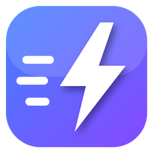
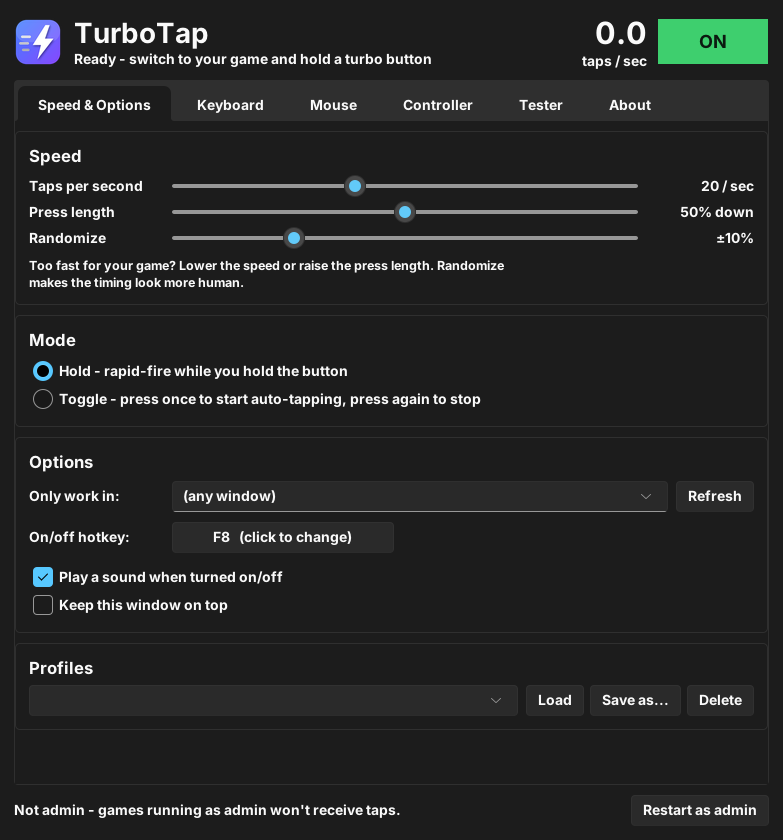
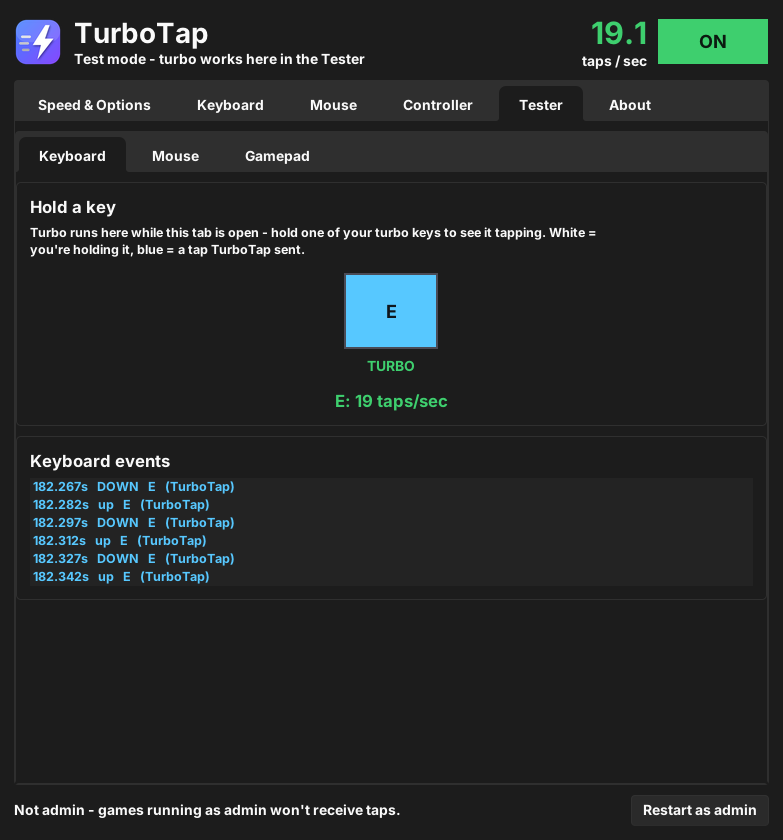
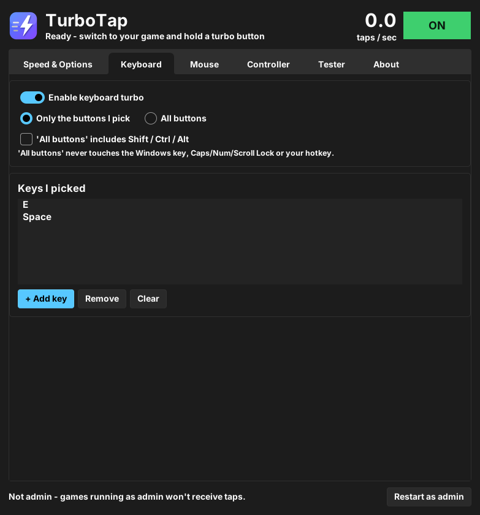
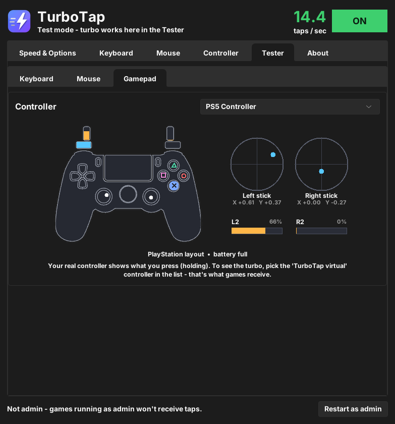
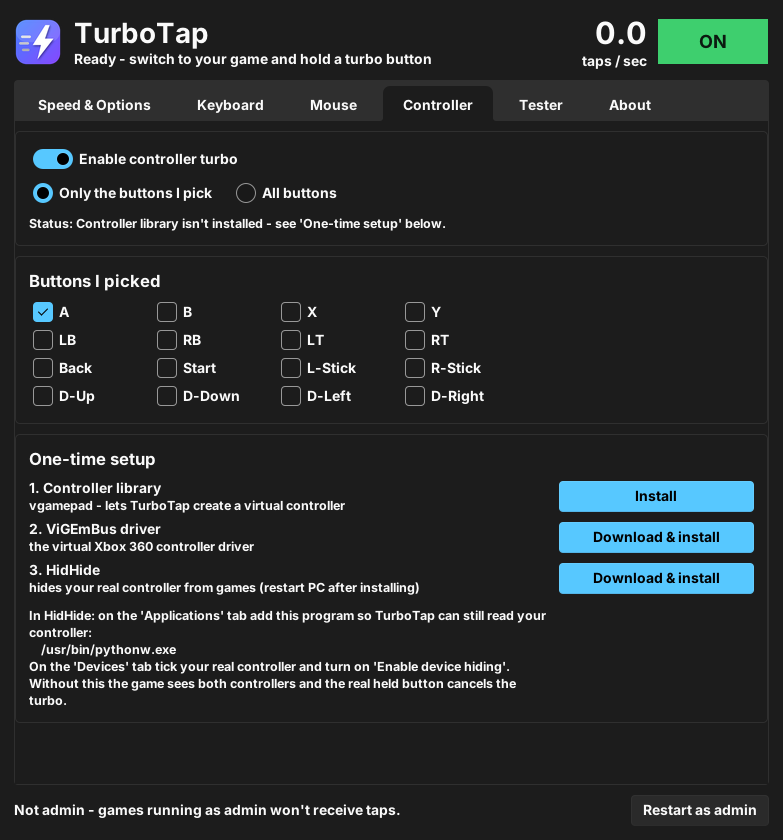
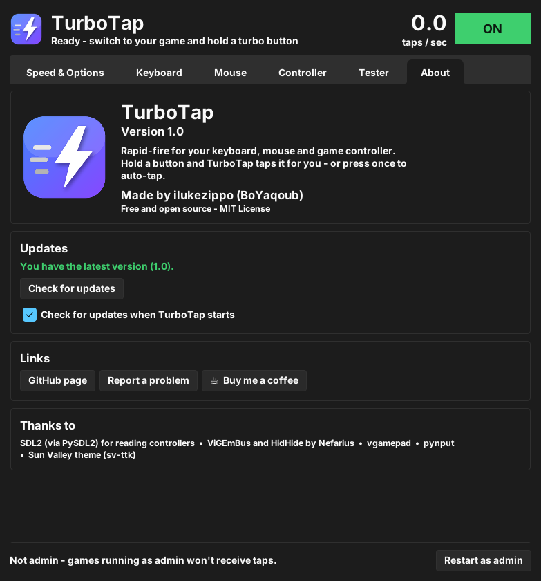

<p align="center">
  
</p>

<h1 align="center">TurboTap</h1>

<p align="center">
  <b>Hold a button. TurboTap taps it for you.</b><br>
  Rapid-fire for your keyboard, mouse and game controller on Windows. One small app, no install.
</p>

<p align="center">
  <a href="../../releases/latest"></a>
  <a href="../../releases/latest"></a>
  
  <a href="LICENSE"></a>
  <a href="../../stargazers"></a>
</p>

<p align="center">
  <a href="https://github.com/ilukezippo/TurboTap/releases/latest/download/TurboTap.exe"></a>
</p>

<p align="center">
  <sub>Downloads <code>TurboTap.exe</code> straight away. Just run it, nothing to install.</sub>
</p>

<p align="center">
  <a href="../../releases/latest">All downloads</a> ·
  <a href="#how-to-use">How to use</a> ·
  <a href="#controller-turbo">Controller turbo</a> ·
  <a href="#questions">Questions</a> ·
  <a href="CHANGELOG.md">What's new</a> ·
  <a href="#build-from-source">Build</a>
</p>

<p align="center">
  
  
</p>

<p align="center"><sub>If TurboTap saves your fingers, a ⭐ star on this page helps other people find it.</sub></p>

---

## Why

Some games want you to hammer the same button over and over: mashing to fill a bar, auto-firing, button-spam combos. TurboTap does the tapping for you. Hold the key (or mouse button, or controller button) and it taps it up to 50 times a second, or press it once to start auto-tapping and again to stop.

## Features

- **Keyboard, mouse and game controller.** Turn each on separately and pick exactly which buttons get turbo, or use **All buttons**.
- **Speed you control.** 1–50 taps per second, how long each tap stays down, and an optional **Randomize** that makes the timing look more human.
- **Hold or Toggle mode.** Hold to rapid-fire, or press once to auto-tap until you press again (Toggle + left click = auto-clicker).
- **Every controller.** PS5 DualSense, PS4, Xbox, Switch Pro and generic controllers, over USB or Bluetooth.
- **Built-in Tester.** Live views of your keyboard, mouse and controller. Turbo runs inside the Tester, so you can watch it working and see the real taps per second.
- **Only in your game.** Optionally limit turbo to one game's window, and it stops when you alt-tab.
- **On/off hotkey** (F8 by default) with a sound, plus **profiles** to save settings per game.
- **Never gets in the way.** TurboTap's own window is never affected, Windows and lock keys are never touched, and it checks GitHub for updates.

## How to use

1. [Download `TurboTap.exe`](https://github.com/ilukezippo/TurboTap/releases/latest/download/TurboTap.exe) and run it.
2. In the **Keyboard** tab, click **+ Add key** and press the key your game needs. (Mouse and Controller work the same way.)
3. Set the speed in **Speed & Options**.
4. Switch to your game and **hold the key**. Press **F8** to turn TurboTap on or off at any time.

> If your game runs as Administrator, click **Restart as admin** at the bottom of TurboTap, otherwise Windows blocks the taps.

<p align="center">
  
  
</p>

## Controller turbo

Windows doesn't let one app press buttons on a real controller, so TurboTap reads your controller and creates a **virtual Xbox 360 controller** that copies it, with turbo added to the buttons you pick. The **Controller** tab sets this up for you:

1. **ViGEmBus driver** – click **Download & install** (creates the virtual controller).
2. **HidHide** – click **Download & install**, then **restart your PC**. HidHide hides your real controller from games so they only see the virtual one; without it the game sees both and the real, held button cancels the turbo.
3. Click **Open HidHide settings**: on *Applications* add `TurboTap.exe`, on *Devices* tick your real controller and turn on *Enable device hiding*.
4. In your game or emulator, pick the **Xbox 360 Controller** as player 1.

In **Tester → Gamepad**, choose *TurboTap virtual* in the list to see exactly what your game receives.

<p align="center">
  
  
</p>

## Questions

**Windows says "Windows protected your PC".** TurboTap isn't code-signed yet. Click *More info → Run anyway*. If Edge holds the download, choose *… → Keep → Show more → Keep anyway*.

**My antivirus complains.** Apps that send key presses, like TurboTap, can trigger a false positive. The full source code is in this repository and the `.exe` is built by GitHub Actions from it.

**Turbo works in the Tester but not in my game.** Run TurboTap as admin if the game runs as admin, check the *Only work in* setting, and for controllers make sure HidHide is set up and the game uses the Xbox 360 controller.

**Can I get banned?** Online games with anti-cheat may treat turbo as a macro. Use it in single-player and offline games.

**Where are my settings?** `%APPDATA%\TurboTap` (settings and profiles).

## Build from source

Requires Windows and Python 3.10+.

```bat
pip install -r requirements.txt
python TurboTap.pyw
```

Build the single-file `TurboTap.exe` (same as the release workflow):

```bat
build.bat
```

Every push to `main` builds the app on GitHub Actions; bumping `APP_VERSION` in `TurboTap.pyw` and adding a `CHANGELOG.md` entry publishes a new release.

## Thanks

[SDL2](https://www.libsdl.org/) via [PySDL2](https://github.com/py-sdl/py-sdl2) for reading controllers · [ViGEmBus](https://github.com/nefarius/ViGEmBus) and [HidHide](https://github.com/nefarius/HidHide) by Nefarius · [vgamepad](https://github.com/yannbouteiller/vgamepad) · [pynput](https://github.com/moses-palmer/pynput) · [Sun Valley theme](https://github.com/rdbende/Sun-Valley-ttk-theme)

## License

[MIT](LICENSE) © ilukezippo (BoYaqoub)

<p align="center"><a href="https://buymeacoffee.com/ilukezippo">☕ Buy me a coffee</a></p>
